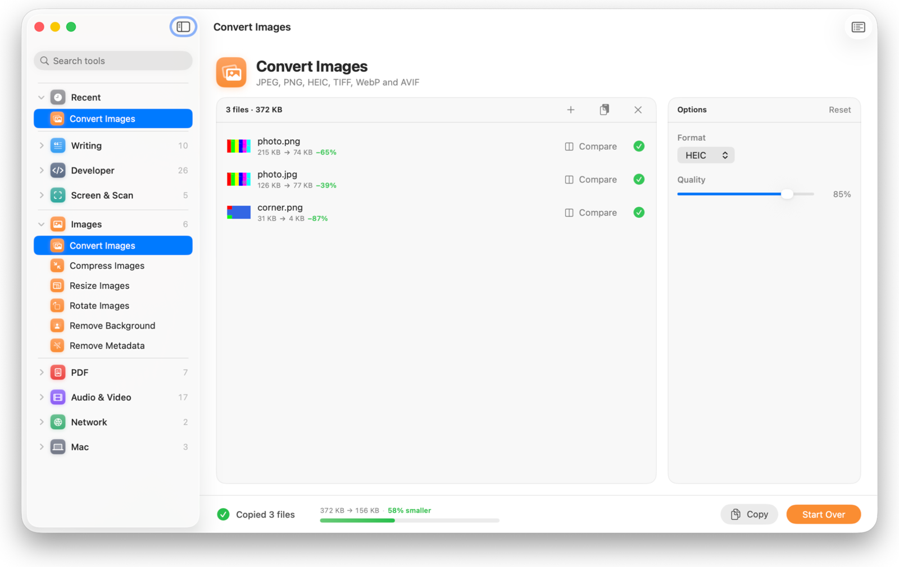
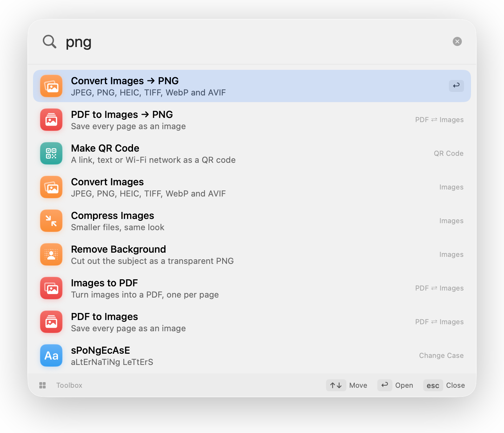
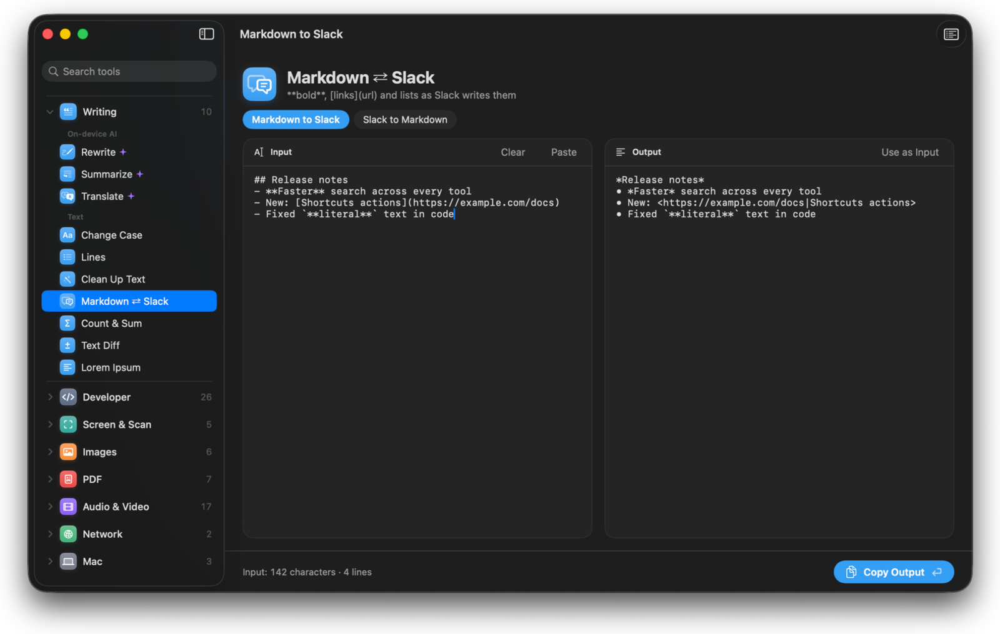
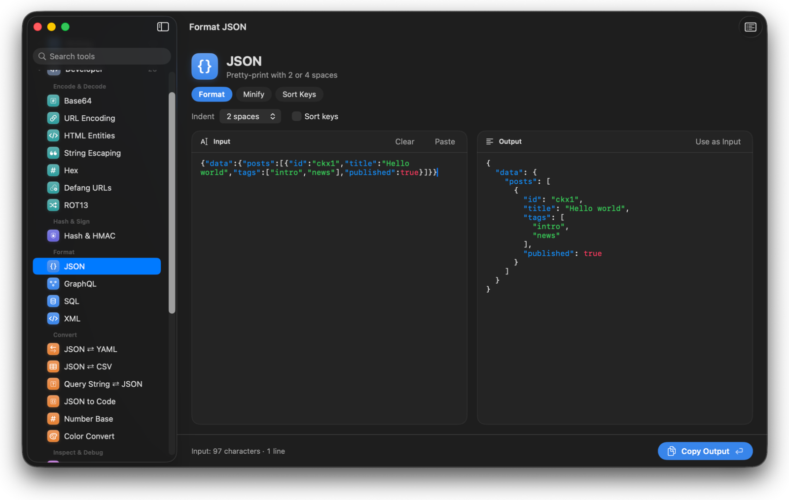
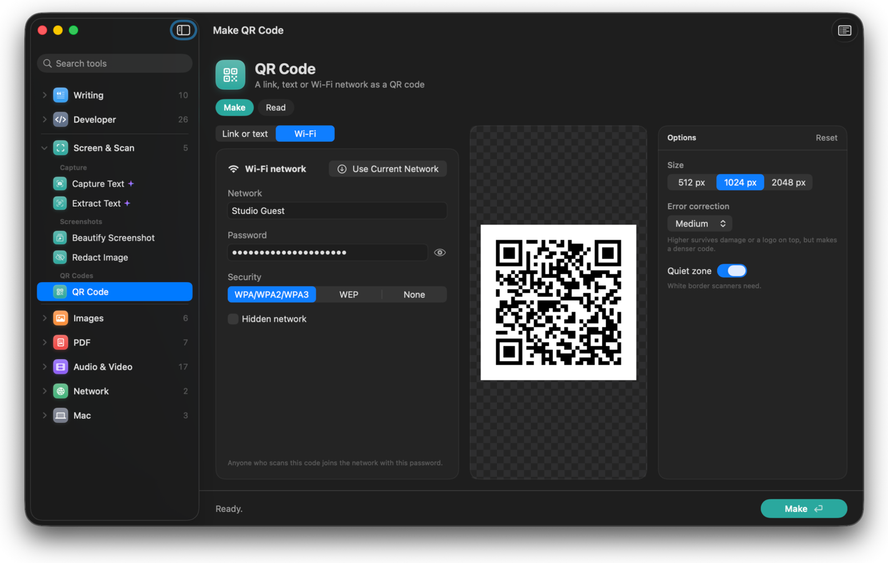
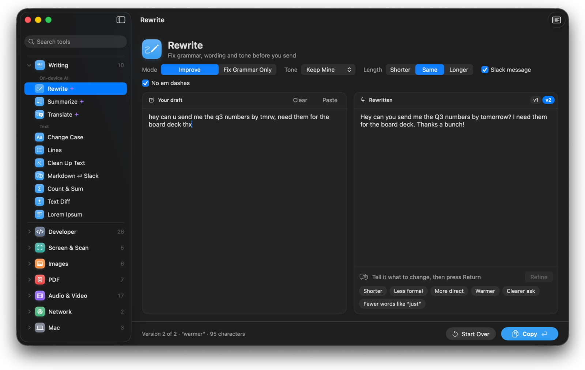

<div align="center">


# Toolbox

**116 everyday tools for your Mac, one keystroke away.**

Convert, compress, format, decode, rewrite and more. Native, fast, and fully on device.


<picture>
  <source media="(prefers-color-scheme: dark)" srcset="docs/images/hero-dark.png">
  
</picture>

</div>

## ⌃⌥Space and go

Press **⌃⌥Space** from any app, type what you need, press Return. Files selected in Finder come along, and the palette shows only the tools that take them. Dropping files on the Dock icon or the menu bar icon works too.

Type a format or a size and the palette offers the tool with that option already set: **png**, **heic**, **mp4**, **mp3**, **1080**.

<p align="center">
  <picture>
    <source media="(prefers-color-scheme: dark)" srcset="docs/images/palette-dark.png">
    
  </picture>
</p>

## What's inside

| Category | Tools |
|---|---|
| ✍️ **Writing** | Rewrite, Summarize and Translate with the on-device model · Change Case · Lines · Markdown ⇄ Slack · Text Diff |
| 🧑‍💻 **Developer** | Base64, URL and HTML encoding · hashes and HMAC · JSON, GraphQL, SQL and XML formatting · JSON ⇄ YAML/CSV · JWT · epoch · cron · IDs |
| 📸 **Screen & Scan** | Capture Text · Extract Text · Beautify Screenshot · Redact Image · QR Code |
| 🖼️ **Images** | Convert · Compress · Resize · Rotate · Remove Background · Remove Metadata |
| 📄 **PDF** | Merge · Split · Organize · Delete or Extract Pages · Password · PDF ⇄ Images |
| 🎬 **Audio & Video** | Trim · Crop · Speed · Merge · Compress · Convert · GIF · Download · Transcribe · Media Info |
| 🌐 **Network** | Speed Test, with history per network · Network Health |
| 💻 **Mac** | Keep Awake · Fix "App Is Damaged" · Batch Rename |

<table>
  <tr>
    <td width="50%"></td>
    <td width="50%"></td>
  </tr>
  <tr>
    <td align="center"><b>70 live text tools.</b> The output updates as you type.</td>
    <td align="center"><b>Syntax colored</b> JSON, GraphQL, SQL, XML, YAML and diffs.</td>
  </tr>
  <tr>
    <td width="50%"></td>
    <td width="50%"></td>
  </tr>
  <tr>
    <td align="center"><b>Wi-Fi QR codes</b> from the network you're on.</td>
    <td align="center"><b>Rewrite</b> with the on-device model, then refine it in a few words.</td>
  </tr>
</table>

## Built for flow

- **Run and Copy.** ⌥-click the run button and the result goes straight to the clipboard: files as files, an image as a picture, text as text. Nothing lands in Downloads.
- **Shortcuts actions.** Convert Images, Compress Images, Extract Text, Rewrite Text, Make QR Code and Format JSON work in Shortcuts, automations and Spotlight.
- **Services in every app.** Select text, right-click, and Rewrite, Fix Grammar or Format JSON in place.
- **Groups with pills.** Related tools share one row (camelCase | snake_case | …), and your text and files carry over when you switch.
- **Notified when done.** Long runs that finish in the background post a notification with Show in Finder.
- **Space to preview.** Quick Look any result from the file list.
- **Private by default.** OCR, transcription, translation and rewriting all run on your Mac. Originals are never changed, except by Batch Rename when you ask it to rename in place.

## Install

```bash
git clone https://github.com/pasqualino/toolbox.git
cd toolbox
./make-app.sh --open
```

This builds `Toolbox.app` in release mode, signs it, registers it and launches it. Needs Xcode 26 and macOS 26. Video, audio and download tools use Homebrew's `ffmpeg` and `yt-dlp`, and WebP output uses `webp`; the app offers to install them.

<details>
<summary><b>Keep permissions across rebuilds</b></summary>

Run `Support/make-signing-identity.sh` once. It creates a self-signed "Toolbox Dev" code-signing certificate in your login keychain and asks for your password to trust it. `make-app.sh` then signs with it, so macOS keeps Screen Recording, Location and other permissions across rebuilds. On the first build, macOS asks to let codesign use the key: enter your password and click **Always Allow**, or it asks on every build.

Without the identity, builds are signed ad hoc and those permissions reset each time. To remove it, delete "Toolbox Dev" in Keychain Access.

</details>

## Reference

<details>
<summary><b>Keyboard</b></summary>

| Keys | Action |
|---|---|
| ⌃⌥Space | Palette, from any app |
| ⌘K | Palette, inside Toolbox |
| ⌘F | Search tools in the sidebar; ↓ moves into the results |
| ⌥⌘S | Focus the sidebar; arrows move, ←/→ collapse and expand, Return opens |
| ⌘1…⌘8, ⌘9, ⌘0 | Categories, Favorites, Recent |
| ⌘O | Choose files |
| ⌘Return / ⌥⌘Return | Run / Run and Copy |
| ⌘. | Stop |
| ⇧⌘R | Show results in Finder |
| ⌃Tab, ⌃⇧Tab | Next or previous pill in a group |
| Space | Quick Look the selected files' results (or originals before a run) |
| ⌘D | Add to Favorites, or remove |
| ⇧⌘N | Open the tool in a new window |
| ⇧⌘⌫ | Clear files |

From the palette, **Return** opens a text tool with the clipboard loaded, and **⌥Return** runs it on the clipboard in place.

</details>

<details>
<summary><b>Results and output</b></summary>

Each run saves to `~/Downloads/Toolbox/<date> <tool>/`; change the folder in Settings. Originals are never changed, except by Batch Rename in "Rename originals" mode. Tools that only produce text show it instead of saving a file.

Run and Copy writes to a cache folder instead, keeping only the latest run. After a normal run, Copy sits next to Show in Finder. A run that takes 10 seconds or more and finishes while Toolbox is in the background posts a notification.

</details>

<details>
<summary><b>Services</b></summary>

Select text or files in any app, then right-click › Services:

| Service | Does |
|---|---|
| Toolbox: Rewrite / Fix Grammar | Replaces the selection with the rewritten text |
| Toolbox: Format JSON | Replaces the selection with formatted JSON |
| Toolbox: Decode JWT | Opens Decode JWT with the token |
| Toolbox: Open Text in Toolbox | Opens the palette with the text loaded |
| Toolbox: Open in Toolbox | Opens the palette with the tools for the selected files |

Give any of them a shortcut in System Settings › Keyboard › Keyboard Shortcuts › Services.

</details>

<details>
<summary><b>Shortcuts actions</b></summary>

| Action | Takes | Gives |
|---|---|---|
| Convert Images | Images, format, quality | Images |
| Compress Images | Images, format, quality | Images |
| Extract Text | An image or PDF | Text |
| Rewrite Text | Text, mode, tone, length (needs Apple Intelligence) | Text |
| Make QR Code | A link or text | PNG |
| Format JSON | JSON, sort keys | Text |

Results go back to Shortcuts; nothing is saved to the output folder. Toolbox runs them in the background without opening its window.

</details>

## Development

| Path | What |
|---|---|
| `Sources/ToolboxCore` | UI-free engine. Each tool is a `Tool` with declarative options and a runner. |
| `Sources/ToolboxCore/Tools` | Tool definitions, by area. `ToolRegistry.swift` collects them. |
| `Sources/Toolbox` | The app: palette, main window, editors, settings. |
| `Sources/toolbox-cli` | Headless runner for tests. |
| `Fixtures` | Test inputs and check scripts. |

`ToolRegistry.layout` in `ToolGroup.swift` decides the categories, sections and groups. [AGENTS.md](AGENTS.md) covers how to add a tool, the code style and how to verify UI changes.

```bash
./test.sh              # build the release CLI and run all 534 checks
./test.sh dev media    # only the scripts whose path contains one of the words
./lint.sh              # swift-format lint; --fix reformats first
```

<details>
<summary><b>CLI and test details</b></summary>

The CLI runs any tool without the app:

```bash
toolbox-cli list                                # every tool and its options
toolbox-cli layout                              # categories and groups; flags tools missing from the layout
toolbox-cli <tool-id> key=value… files…         # file tools
toolbox-cli <tool-id> --text "…"                # text tools; or pipe stdin
```

Always test release builds: optimizations once exposed an engine bug that debug builds hid. `test.sh` prints each failure with what it wanted and got.

| Script | Checks | Covers |
|---|---|---|
| `Fixtures/dev/check-{enc,fmt,txt}.sh` | 292 | Text tools |
| `Fixtures/media/check-media.sh` | 48 | Audio and video |
| `Fixtures/check-other.sh` | 27 | Image, PDF, AI, download |
| `Fixtures/batch1/check-*.sh` | 167 | Image edits, Mac, media extras, network |

`check-mac.sh`, `check-net.sh` and `check-other.sh` need a network connection. To run one script by hand: `CLI=$PWD/.build/release/toolbox-cli zsh Fixtures/dev/check-txt.sh`.

`./make-app.sh --debug-hooks` adds the `TOOLBOX_SNAPSHOT` screenshot and `TOOLBOX_DEBUG` logging hooks (`Sources/Toolbox/App/Snapshot.swift`). Normal builds leave them out.

</details>
